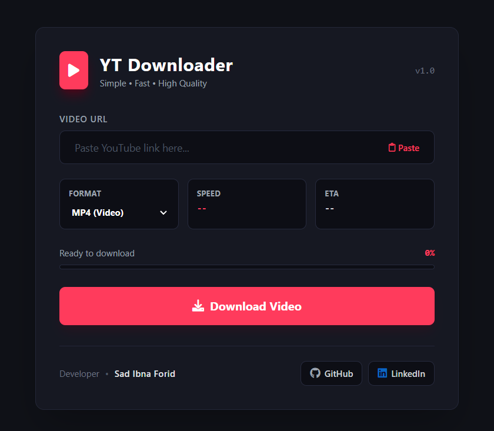

# 🎬 YT Downloader

A sleek, fast, and modern web application to download YouTube videos and audio. Powered by **Flask** and **yt-dlp**, featuring real-time download progress tracking, speed and ETA stats, and automatic server cleanup.

<p align="center">
  
  <br />
  <em>YT Downloader — Modern dark-mode UI with live progress & stats</em>
</p>

---

## ✨ Features

- 🎥 **Dual Format Support:**
  - **MP4 (Video):** Downloads the best available video stream combined with the highest quality audio track.
  - **MP3 (Audio):** Extracts high-fidelity audio (192 kbps) using FFmpeg.
- ⚡ **Live Download Progress:**
  - Real-time progress bar.
  - Live download speed (e.g., `5.2MiB/s`) and estimated time remaining (ETA).
- 📋 **One-Click Clipboard Paste:** Quick paste button to automatically grab URLs from your clipboard.
- 🎨 **Modern Dark UI:** Clean, responsive interface styled with **Tailwind CSS** and **FontAwesome** icons.
- 🧹 **Automatic Cleanup:** Files are downloaded into isolated temporary directories and automatically deleted from the server right after the transfer completes.
- 🔒 **Session Isolation:** Uses unique client session IDs to prevent cross-request collisions during multi-user sessions.

---

## 🛠️ Tech Stack

- **Backend:** [Python 3.x](https://www.python.org/), [Flask 3.0.3](https://flask.palletsprojects.com/)
- **Media Engine:** [yt-dlp](https://github.com/yt-dlp/yt-dlp)
- **Audio/Video Processing:** [FFmpeg](https://ffmpeg.org/)
- **Frontend:** HTML5, [Tailwind CSS (CDN)](https://tailwindcss.com/), [FontAwesome](https://fontawesome.com/), Vanilla JavaScript (Fetch API, Clipboard API)

---

## 📋 Prerequisites

Before running the application, make sure you have installed:

1. **Python 3.8+** (check via `python --version`)
2. **FFmpeg** *(Required for merging video/audio formats and MP3 conversion)*:
   - **Windows:**
     ```powershell
     winget install "FFmpeg (Essentials Build)"
     # OR via Chocolatey:
     choco install ffmpeg
     ```
   - **macOS:**
     ```bash
     brew install ffmpeg
     ```
   - **Linux (Ubuntu/Debian):**
     ```bash
     sudo apt update && sudo apt install ffmpeg -y
     ```
   > Verify FFmpeg installation by running: `ffmpeg -version`

---

## 🚀 Getting Started

### 1. Clone the Repository
```bash
git clone https://github.com/YOUR_USERNAME/youtube-downloader.git
cd youtube-downloader
```

### 2. Create and Activate a Virtual Environment (Recommended)

- **On Windows:**
  ```powershell
  python -m venv venv
  venv\Scripts\activate
  ```

- **On macOS / Linux:**
  ```bash
  python3 -m venv venv
  source venv/bin/activate
  ```

### 3. Install Dependencies
```bash
pip install -r requirements.txt
```

### 4. Run the Application
```bash
python app.py
```

### 5. Access the Web App
Open your browser and navigate to:
```
http://localhost:5000
```

---

## 📂 Project Structure

```plaintext
youtube-downloader/
├── static/
│   ├── css/
│   │   └── style.css          # Custom scrollbars and styling rules
│   └── js/
│       └── script.js          # Polling, clipboard handler, and UI state logic
├── templates/
│   └── index.html             # Main responsive application template
├── .gitignore                 # Excluded environments and temporary media files
├── app.py                     # Flask application routes and yt-dlp handling
├── requirements.txt           # Python package requirements
└── README.md                  # Project documentation
```

---

## ⚙️ How It Works

1. **Client Request:** When the user enters a YouTube URL and clicks "Download Video", the frontend generates a unique UUID (`client_id`) using `crypto.randomUUID()`.
2. **Download Initiation:** The frontend posts the URL, selected format (`mp4` or `mp3`), and `client_id` to the `/download` endpoint.
3. **Live Progress Tracking:**
   - `yt-dlp` runs with a `progress_hook` that updates an in-memory dictionary keyed by `client_id` with current percentage, download speed, and ETA.
   - The browser polls `/progress/<client_id>` every 500ms to update the UI progress bar and stats in real time.
4. **Delivery & Clean-up:**
   - Once downloading and optional FFmpeg post-processing finish, the file is delivered as an attachment to the user's browser.
   - Using Flask's `@after_this_request` hook, the server immediately wipes the temporary file and directory, releasing disk space.

---

## 💡 Troubleshooting

- **`yt-dlp` extraction issues or YouTube changes:**
  YouTube regularly updates its player logic. Keep `yt-dlp` updated to the latest release:
  ```bash
  pip install --upgrade yt-dlp
  ```
- **MP3 conversion fails:**
  Ensure **FFmpeg** is installed and accessible in your system's `PATH`. Run `ffmpeg -version` in your terminal to verify.

---

## 🤝 Contributing

Contributions, bug reports, and feature requests are welcome!
1. Fork the Project
2. Create your Feature Branch (`git checkout -b feature/AmazingFeature`)
3. Commit your Changes (`git commit -m 'Add some AmazingFeature'`)
4. Push to the Branch (`git push origin feature/AmazingFeature`)
5. Open a Pull Request

---

## 👨‍💻 Author

**Sad Ibna Forid**
- **GitHub:** [Sad Ibna Forid](https://github.com/sadudoy)
- **LinkedIn:** [Sad Ibna Forid](https://www.linkedin.com/in/sadudoy)

---

## 📄 License

This project is licensed under the [MIT License](LICENSE).

---

## ⚠️ Disclaimer

This tool is created for educational and personal archival purposes only. Please respect YouTube's Terms of Service and copyright laws in your jurisdiction before downloading content.

